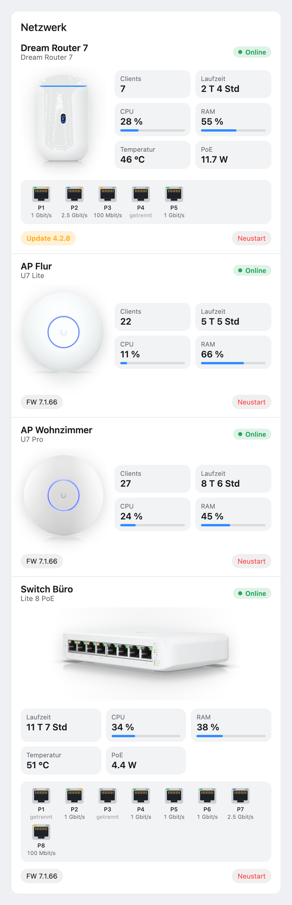
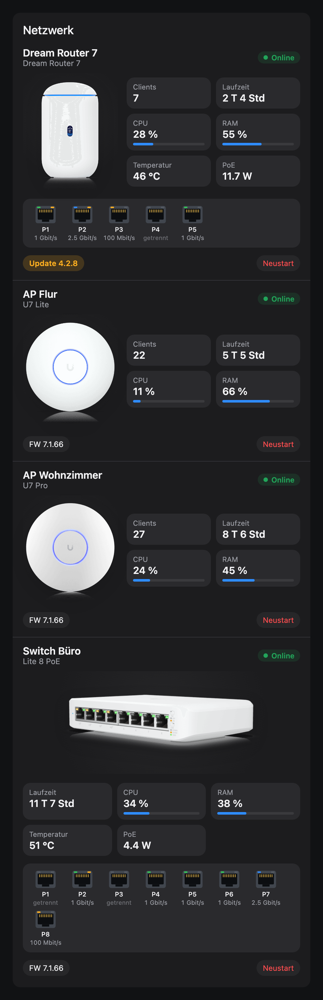
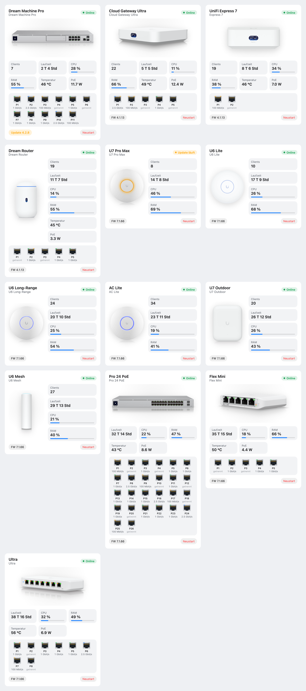

# UniFi Network Card

[English](README.md) · **Deutsch**

Eine Lovelace-Karte für die offizielle **UniFi Network**-Integration von Home Assistant. Sie zeigt
Gateways, Access Points und Switches mit **echten Ubiquiti-Produktfotos**, dazu den Status direkt auf
der echten Status-LED des Geräts, Clients, Laufzeit, CPU/RAM, Temperatur, Ports mit Geschwindigkeit
und PoE, Firmware-Updates und einen Neustart-Button. Alles lässt sich im grafischen Editor einstellen,
YAML ist nicht nötig.

<table>
  <tr>
    <td></td>
    <td></td>
  </tr>
</table>

## Funktionen

- **Über 200 UniFi-Modelle werden automatisch erkannt**: Dream Machines, Dream Router, Cloud Gateways,
  UniFi Express, Access Points der Serien U6/U7/E7/AC, Switches der Serien Lite/Flex/Pro/Ultra/Enterprise
  und mehr. Die Erkennung nutzt Ubiquitis internen Modellcode (z. B. `UDMA67A` = Dream Router 7) und
  funktioniert deshalb auch bei umbenannten Geräten.
- **Echte Produktfotos** von Ubiquiti, auf das Gerät zugeschnitten. Breite Geräte wie Rack-Gateways und
  Switches werden quer dargestellt.
- **Status auf der echten LED**: online das originale Blau; bei „Update läuft“ oder „Wird provisioniert“
  leuchtet der LED-Ring bzw. die Lichtleiste orange und pulsiert. Offline-Geräte werden ausgegraut.
- **Ports** mit Verbindungsgeschwindigkeit (`1 Gbit/s`, `2.5 Gbit/s`, `getrennt`), Link-Lampe,
  PoE-Anzeige und -Leistung, auch für SFP+.
- Clients, Laufzeit, CPU, RAM, Temperatur, WAN-Latenz, PoE-Verbrauch, Firmware-Version mit Update-Hinweis,
  Neustart-Button (mit Rückfrage).
- Design **hell, dunkel oder automatisch** (folgt dem Home-Assistant-Theme).
- Oberfläche auf **Deutsch und Englisch**, automatisch passend zur Sprache von Home Assistant (oder fest einstellbar).
- Funktioniert mit jeder Home-Assistant-Sprache: Sensoren werden am Typ und an englischen wie deutschen Namen erkannt.
- Klick auf Werte, Ports oder Foto öffnet die Details, Klick auf den Gerätenamen die Geräteseite.



## Installation

### Über HACS (empfohlen)

1. **HACS → ⋮ → Benutzerdefinierte Repositories**
2. `https://github.com/Biolaxy/unifi-network-card` mit Typ **Dashboard** hinzufügen.
3. „UniFi Network Card“ suchen und herunterladen. HACS registriert die Ressource automatisch.
4. Seite neu laden (Strg/Cmd + Shift + R) und die Karte hinzufügen: **Karte hinzufügen → „UniFi Network Card“**.

### Manuell

1. `unifi-network-card.js` nach `/config/www/` kopieren.
2. **Einstellungen → Dashboards → ⋮ → Ressourcen → Ressource hinzufügen**
   - URL: `/local/unifi-network-card.js?v=1.5.0`
   - Typ: **JavaScript-Modul**
3. Seite neu laden (Strg/Cmd + Shift + R) und die Karte hinzufügen.

## Sensoren aktivieren

Die UniFi-Network-Integration **schaltet viele Sensoren standardmäßig aus**. Aktiviere die gewünschten
unter **Einstellungen → Geräte & Dienste → UniFi Network → dein Gerät → Entitäten**, zum Beispiel:

- *Clients*, *CPU-Temperatur*, *WAN-Latenz* (z. B. Cloudflare)
- je Port: *Verbindungsgeschwindigkeit* (auch SFP+), *PoE*, *PoE-Leistung*

*Betriebszeit*, *Zustand*, *CPU-* und *Speicherauslastung* sind bereits aktiv.

## Konfiguration (grafischer Editor)

**Darstellung:** Titel, Design (Automatisch / Hell / Dunkel), Sprache (Automatisch / Deutsch / Englisch), Original-Produktfotos an/aus,
Ports, Firmware und Neustart-Button ein- oder ausblenden.

**Geräte:** Geräte auswählen. Leer lassen zeigt alle UniFi-Geräte automatisch.

**Reihenfolge:** Geräte am Griff (⠿) mit Maus oder Finger ziehen oder mit den Pfeil-Knöpfen verschieben.

**Pro Gerät:** Anzeigename, Modell erzwingen (falls ein Gerät falsch erkannt wird), eigenes Bild.

<details>
<summary>YAML-Referenz (optional)</summary>

```yaml
type: custom:unifi-network-card
title: Netzwerk
theme: dark                # auto (Standard) | light | dark
language: de               # auto (Standard, wie Home Assistant) | de | en
photos: false              # Standard: true
devices:                   # weglassen = alle UniFi-Geräte automatisch
  - 1a2b3c4d5e...          # Geräte-IDs
order:                     # Anzeigereihenfolge (Geräte-IDs), übrige folgen danach
  - 9f8e7d6c...
  - 1a2b3c4d5e...
overrides:                 # pro Gerät (Geräte-ID)
  1a2b3c4d5e...:
    name: AP Wohnzimmer
    model: U7-Pro          # jede Ubiquiti-SKU oder gateway / ap-round / ap-square / switch (Grafik)
    image: /local/unifi/mein-ap.png
show_ports: false          # Standard: true
show_firmware: false       # Standard: true
show_restart: false        # Standard: true
```

Ältere Einstellungen (`model: udr7`, `model: u7lite` oder Objekte in `devices`) funktionieren weiterhin
und werden im Editor automatisch übernommen.
</details>

## Produktfotos

Die Fotos werden beim Anzeigen von Ubiquitis Bilddienst (`images.svc.ui.com`) geladen. Der Browser,
der das Dashboard zeigt, braucht also Internet. Ohne Internet oder für eigene Bilder: transparentes PNG
nach `/config/www/unifi/` legen und beim Gerät als **Eigenes Bild** eintragen (z. B.
`/local/unifi/mein-ap.png`). Lädt ein Foto nicht, zeigt die Karte eine gezeichnete Grafik.

## Entwicklung

- `demo.html`: Demo mit simulierten Geräten (`?set=home|gateways|aps|switches|all`, `&lang=de|en`, `&split`, `#dark`).
- `test.html`, `test-de.html`, `editor-test.html`: Tests für Darstellung, deutsche Entitätsnamen, Sprachen, Drag & Drop und Editor.
- `tools/`: baut die Geräteliste aus Ubiquitis öffentlichen Daten neu
  (`static.ui.com/fingerprint/ui/public.json` und techspecs.ui.com), ermittelt Status-LED und
  Geräteumriss in jedem Foto (`analyze-leds.html`) und erstellt die README-Bilder (`snapshot.js`).
  Details stehen in `tools/build-device-db.mjs`.

```bash
python3 -m http.server 8765   # dann http://localhost:8765/demo.html öffnen
```

## Hinweis

Kein offizielles Produkt von Ubiquiti und nicht mit Ubiquiti Inc. verbunden. UniFi ist eine Marke von
Ubiquiti Inc. Die Produktfotos gehören Ubiquiti. Die Karte lädt sie direkt von Ubiquitis Servern, die
Bildschirmfotos in `docs/` zeigen sie nur zur Veranschaulichung.

Lizenz: MIT
