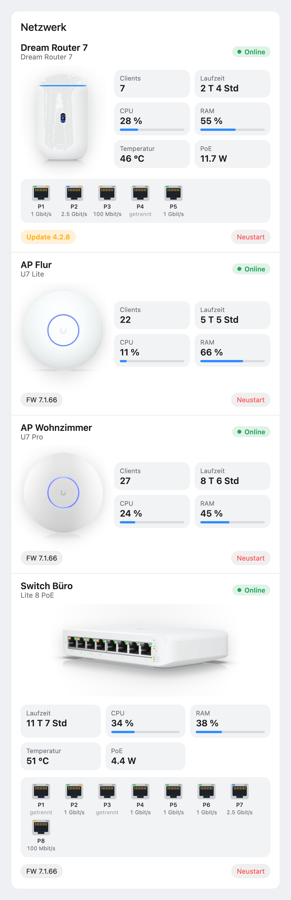
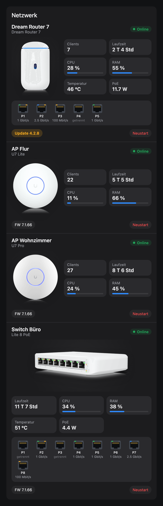
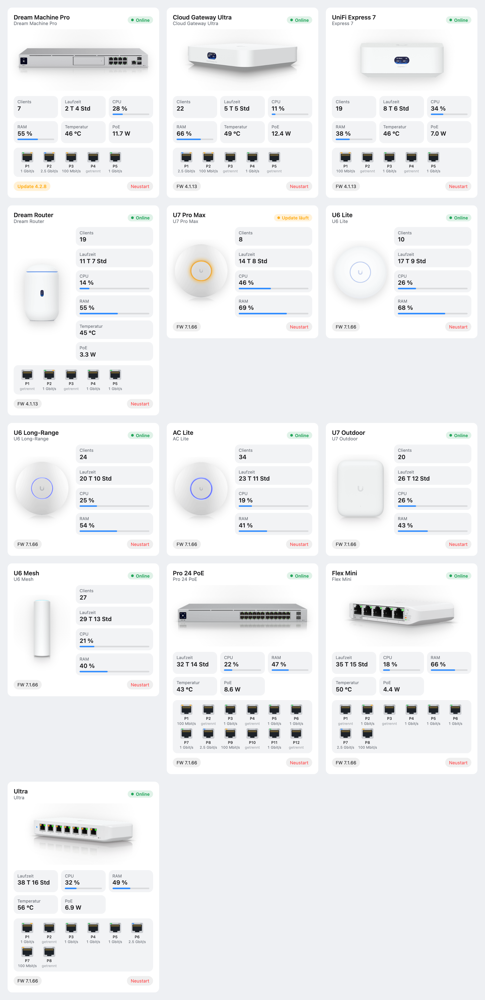

# UniFi Network Card

**English** · [Deutsch](README.de.md)

A Home Assistant Lovelace card for the official **UniFi Network** integration. It shows your gateways,
access points and switches with **real Ubiquiti product photos**, live status on the device's actual
status LED, clients, uptime, CPU/RAM, temperature, ports with link speed and PoE, firmware updates and
a restart button. Everything can be configured in the visual editor, so no YAML is needed.

<table>
  <tr>
    <td></td>
    <td></td>
  </tr>
</table>

## Features

- **Over 200 UniFi models recognised automatically**: Dream Machines, Dream Routers, Cloud Gateways,
  UniFi Express, U6/U7/E7/AC access points, Lite/Flex/Pro/Ultra/Enterprise switches and more.
  Detection uses Ubiquiti's internal model code (e.g. `UDMA67A` = Dream Router 7), so it works even
  if you renamed the device.
- **Real product photos** from Ubiquiti, cropped to the device. Wide devices such as rack gateways and
  switches are shown in landscape.
- **Status on the real LED**: the original blue light while online; when the device is updating or
  provisioning, its LED ring or bar lights up orange and pulses. Offline devices are greyed out.
- **Ports** with link speed (`1 Gbit/s`, `2.5 Gbit/s`, `getrennt` = disconnected), link LED, PoE
  indicator and power. SFP+ ports are included.
- Clients, uptime, CPU, RAM, temperature, WAN latency, PoE budget, firmware version and update badge,
  restart button (with confirmation).
- **Light, dark or automatic** design (follows your Home Assistant theme).
- **Language independent**: sensors are detected by type and by English or German names.
- Click any value, port or the photo to open its details; click the device name to open the device page.



## Installation

### HACS (recommended)

1. **HACS → ⋮ → Custom repositories**
2. Add `https://github.com/Biolaxy/unifi-network-card` with type **Dashboard**.
3. Search for "UniFi Network Card" and download it. HACS registers the resource automatically.
4. Reload the page (Ctrl/Cmd + Shift + R) and add the card: **Add card → "UniFi Network Card"**.

### Manual

1. Copy `unifi-network-card.js` to `/config/www/`.
2. **Settings → Dashboards → ⋮ → Resources → Add resource**
   - URL: `/local/unifi-network-card.js?v=1.4.0`
   - Type: **JavaScript module**
3. Reload the page (Ctrl/Cmd + Shift + R) and add the card.

## Enable the sensors

The UniFi Network integration **disables many sensors by default**. Enable the ones you want under
**Settings → Devices & services → UniFi Network → your device → Entities**, for example:

- *Clients*, *CPU temperature*, *WAN latency* (e.g. Cloudflare)
- per port: *Link speed* (including SFP+), *PoE*, *PoE power*

*Uptime*, *State*, *CPU* and *Memory utilization* are enabled by default.

## Configuration (visual editor)

**Appearance:** title, design (automatic / light / dark), original product photos on/off,
show or hide ports, firmware and restart button.

**Devices:** pick devices, or leave empty to show all UniFi devices automatically.

**Order:** move devices up and down with the arrow buttons.

**Per device:** display name, force a model if a device is detected incorrectly, custom image.

<details>
<summary>YAML reference (optional)</summary>

```yaml
type: custom:unifi-network-card
title: Network
theme: dark                # auto (default) | light | dark
photos: false              # default: true
devices:                   # omit = all UniFi devices automatically
  - 1a2b3c4d5e...          # device IDs
order:                     # display order (device IDs), others follow
  - 9f8e7d6c...
  - 1a2b3c4d5e...
overrides:                 # per device (device ID)
  1a2b3c4d5e...:
    name: Living room AP
    model: U7-Pro          # any Ubiquiti SKU, or gateway / ap-round / ap-square / switch (drawn graphic)
    image: /local/unifi/my-ap.png
show_ports: false          # default: true
show_firmware: false       # default: true
show_restart: false        # default: true
```
</details>

## Product photos

The photos are loaded at display time from Ubiquiti's image service (`images.svc.ui.com`), so the
browser showing the dashboard needs internet access. Without it, or for your own pictures, place a
transparent PNG in `/config/www/unifi/` and set it as **Custom image** for the device
(e.g. `/local/unifi/my-ap.png`). If a photo cannot be loaded, the card falls back to a drawn graphic.

## Development

- `demo.html`: demo with simulated devices (`?set=home|gateways|aps|switches|all`, `&split`, `#dark`).
- `test.html`, `test-de.html`, `editor-test.html`: tests for rendering, German entity names and the editor.
- `tools/`: rebuilds the device list from Ubiquiti's public data
  (`static.ui.com/fingerprint/ui/public.json` and techspecs.ui.com), detects the status LED and the
  device outline in each photo (`analyze-leds.html`) and creates the README images (`snapshot.js`).
  See the comments in `tools/build-device-db.mjs`.

```bash
python3 -m http.server 8765   # then open http://localhost:8765/demo.html
```

## Disclaimer

Not an official Ubiquiti product and not affiliated with Ubiquiti Inc. UniFi is a trademark of
Ubiquiti Inc. Product photos are property of Ubiquiti. The card loads them directly from Ubiquiti's
servers; the screenshots in `docs/` show them for illustration only.

License: MIT
